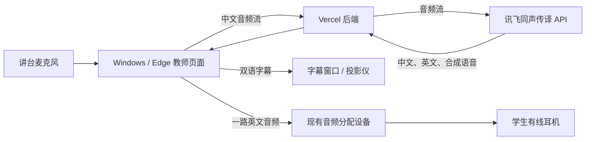

**课堂中文授课转英文语音与双语字幕：V0 实施方案**

版本：V0｜整理日期：2026 年 10 月 16 日

本文汇总已确认的需求，并给出开发、联调和现场验收步骤。V0 的目标是验证完整流程和连续运行能力；正式教学适用性依据实测另行评估。文中的技术实现是建议基线，未表示已经开发或验证通过。

**一、目标与使用场景**

教师用中文授课，系统实时生成中英文字幕和英文语音。字幕在一个投影仪上显示；英文语音由电脑输出至教室现有音频分配设备，再经有线耳机供学生收听。另一个投影仪显示教师准备的双语 PPT。

| 项目 | 已确认条件 |
| --- | --- |
| 教学规模 | 1 间教室、25 名外国留学生、同一门课、同一路英文 |
| 单节时长 | 45 分钟 |
| 操作者 | 授课教师本人 |
| 开发环境 | Mac |
| 使用环境 | 教室 Windows 电脑，可能为 Windows 10 或 11；使用 Edge，具体版本待确认 |
| 采音 | 讲台上的麦克风，教师固定站位、不走动 |
| 音频输出 | 电脑连接现有音频分配设备，教室有 30 套耳机；具体型号和接口待现场确认 |
| 显示设备 | 两个投影仪，可显示不同画面，采用 VGA 连接 |
| 部署选择 | 优先尝试 Vercel；教室电脑不部署后端 |
| 网络约束 | 学校电脑不能依赖 VPN，不能要求教师访问 GitHub、Vercel 管理后台等平台 |
| 数据处理 | 允许实时发送音频给云端 API；不需要手动上传录音文件，不需要课后保存录音 |
| 供应商数据留存 | 当前不作为 V0 前置调查或阻塞条件 |
| 经费 | 暂无明确预算，先使用讯飞对应服务的免费额度 |
| 周末开发条件 | 在家开发，暂时无法验证学校设备和网络 |

25 名学生共享一份翻译结果，软件只建立一路课堂翻译会话，耳机数量不直接转换为 API 并发数。双语 PPT 能辅助理解，但不会自动让翻译服务获得专业术语信息。

**二、V0 范围**

| 模块 | 必须实现的行为 |
| --- | --- |
| 课前检查 | 检查浏览器能力、麦克风权限与输入音量、服务连接；提供英文测试音试听 |
| 课堂控制 | 开始、暂停／继续、结束，操作状态明确 |
| 中文识别 | 连续采集教师中文，展示识别结果 |
| 英文翻译 | 展示英文翻译，与对应中文片段关联 |
| 英文播放 | 按顺序播放合成语音，支持音量调整和清空待播内容 |
| 字幕投影 | 独立字幕窗口，支持全屏、字号调整及高对比度显示 |
| 运行状态 | 显示采音、连接、翻译、播放状态和待播时长；异常使用教师能理解的提示 |
| 恢复 | 自动重连、手动重试，恢复后显示状态；不能一直显示虚假的“翻译中” |
| 验证数据 | 记录延迟、积压、连接恢复与用量估算，不记录课堂音频正文 |

V0 暂不包含：专业术语库和 PPT 内容读取、学生英文提问转中文、多语言与多教室、学生手机端、录音归档与回放、字幕历史导出、离线翻译，以及 PPT 视频音频采集或混音。

教师原则上不播放 PPT 视频；确需播放时，先暂停同传，结束后继续。

**三、总体方案**

课堂的主要数据流如下：

建议前端使用 React、TypeScript，后端使用 Node.js 和 WebSocket，前后端部署在同一 Vercel 项目下。学校端只打开应用网页，不安装开发工具或运行后端。开发框架版本在实施时锁定，以部署验证结果为准。

讯飞文档提供流式识别、翻译和语音输出，并明确该接口不适合浏览器直接调用。因此通过后端中转，调用凭证放在后端配置中。音频输入按接口要求转换为 16 kHz、16 bit、单声道 PCM，并按推荐节奏发送；不能直接把浏览器默认录音格式当作兼容输入。[讯飞同声传译接口文档](https://www.xfyun.cn/doc/nlp/simultaneous-interpretation/API.html)

Vercel 当前提供 WebSocket Beta，但连接会在函数达到最大运行时长后关闭，重新连接也可能落到另一个实例。部署时核实实际套餐、功能可用性和时长配置，并验证两段连接：浏览器到 Vercel、Vercel 到讯飞。45 分钟课堂不能依赖一条连接始终存活。[Vercel WebSocket 文档](https://vercel.com/docs/functions/websockets)

**四、关键实现约定**

| 项目 | 实现方式 |
| --- | --- |
| 单一音频来源 | 教师控制页负责采音、连接服务和播放；字幕窗口只显示结果，不重复调用 API、不重复播音 |
| 麦克风处理 | 浏览器进行必要的音频采集、重采样和分片，避免在旧电脑本地运行识别或翻译模型 |
| 字幕更新 | 正确处理追加、修订和最终结果，避免把每次中间结果都追加为新句子；中英按片段关联 |
| 字幕历史 | 只在本次页面会话中保留有限的近期文本，限制页面节点数量，防止长课越跑越慢 |
| 投影同步 | 同一浏览器的同源窗口共享当前状态；新开或重新打开字幕窗口时可取得最近字幕 |
| 播放队列 | 按片段顺序播放，统计实际待播秒数；不因返回顺序变化而乱序播放 |
| 字幕与声音 | 字幕优先及时显示，英文音频顺序播放；不承诺逐字音画同步 |
| 音频输出 | 优先使用 Windows 已设定的输出设备；课前试听确认声音进入耳机线路 |
| 连接恢复 | 浏览器保留有限的字幕及控制状态；新连接重建讯飞会话，不假设服务器内存状态会跨连接保留 |
| 过期数据 | 用会话和片段标识过滤旧连接的迟到结果，避免结束后播音、恢复后重复句子 |
| 数据保存 | 音频仅作有界的短时传输与播放缓冲，不落盘、不写数据库；日志不记录音频载荷、完整课堂字幕或凭证 |
| 基础存储 | V0 不引入课堂内容数据库；实时状态保存在页面会话内，刷新后不恢复课堂历史 |

字幕修订和最终结果的处理依据讯飞返回协议实现。[讯飞返回结果说明](https://www.xfyun.cn/doc/nlp/simultaneous-interpretation/API.html#返回结果)

**五、教师操作流程**

1. 打开应用，完成麦克风检查和耳机试听。
2. 打开字幕窗口，移动至对应投影画面并全屏；另一投影画面显示双语 PPT。
3. 点击“开始”，允许麦克风和音频播放，正常中文授课。
4. 临时离开授课或播放视频时点击“暂停”：停止采音上传、停止英文播放并清空待播内容，关闭当前 API 会话；继续时建立新会话，暂停期间的内容不补译。
5. 若英文明显落后，查看待播状态，必要时点击“清空待播，回到当前”。已跳过的内容不自动补播。
6. 下课点击“结束”：释放麦克风、关闭连接并清空音频队列。当前字幕可暂留供查看，刷新或关闭页面后清除。

提示文字使用“麦克风未授权”“连接中断，正在重试”“服务额度不足”等表达；平台内部错误码放在排查信息中。

**六、异常处理**

| 情况 | 系统行为 | 教师应对 |
| --- | --- | --- |
| 麦克风未授权、无输入 | 提示授权或检查设备，不能伪装为正常授课 | 按提示恢复后开始 |
| 临时断连 | 有限次数自动重试，采用逐步延长的重试间隔，保留已显示字幕 | 等待恢复，必要时手动重试 |
| 函数时限或 API 会话结束 | 自动重建连接和会话，尽可能选择合适句间交接，记录交接中断 | 若有内容缺失，重述关键句 |
| 英文播放积压 | 显示待播时长，提供清空按钮，不静默跳过课堂内容 | 决定是否清空并回到当前 |
| 仅英文播放通道故障 | 字幕仍可用时继续显示，提示检查音量和输出线路 | 检查耳机及电脑声音设置 |
| 免费额度耗尽、鉴权失败 | 停止无效重试，明确提示需处理账号或额度；不自动购买套餐 | 暂停同传，联系项目负责人 |
| 持续断网或服务不可达 | 停止宣称正在实时翻译，保留已有字幕 | 使用已有双语 PPT，决定暂停或调整授课 |

自动重连不等于无损恢复。中断期间不积累无限音频，也不在恢复后补播大量过时内容；若发生未覆盖区间，应明确提示。V0 不建设离线备用翻译。

**七、账号与费用准备**

讯飞账号目前尚未就绪。按以下分工完成：

1. 项目负责人远程指导负责管理外国学生的同事注册新账号，由同事完成实名认证。
2. 项目负责人使用该账号开通“同声传译”API、领取对应免费额度并取得调用凭证。
3. 检查账户实际到账时长、有效期、并发和服务权限，再用一小段中文验证识别、翻译、英文语音三类输出。
4. 将凭证配置到后端，完成真实 API 联调。

免费额度以实际账户控制台为准，不把文本翻译等其他服务额度视为同传额度。接口试用和排查同样消耗额度；应用可记录会话时长估算，但官方账单和剩余额度以供应商控制台为准。[讯飞同声传译产品页](https://www.xfyun.cn/services/msi?ch=bd69-cy)

Vercel 的计算、流量和可选域名成本需要单独核实，不能由“讯飞免费”推出整套系统长期免费。首轮仅在现有可用额度内验证，超额后提示停止，不自动购买或升级。

**八、实施步骤与阶段产物**

以下按依赖关系推进，不预设必须在一个周末完成全部联调。

| 阶段 | 工作内容 | 完成条件／产物 |
| --- | --- | --- |
| A：部署与连接验证 | 建立最小前后端，部署 Vercel；验证网页到后端的双向连接、主动断连重连和当前运行时限制 | 可访问的测试地址与连接验证记录；讯飞账号未就绪也能完成此阶段 |
| B：模拟完整流程 | 实现教师页面、字幕窗口、采音、模拟双语结果、测试英文音频、播放队列和异常提示 | 明确标注模拟模式，可检查交互和 45 分钟前端稳定性；不冒充真实翻译 |
| C：账号准备 | 完成注册、实名、服务开通、领取额度和短音频调用 | 同传服务调用成功，后端具备所需凭证；可与 A、B 同期推进 |
| D：真实 API 接入 | 完成 PCM 音频流、鉴权、结果修订、语音播放、连接恢复与会话交接 | 真实麦克风输入能持续返回中英字幕和英文声音，正确处理停止及恢复 |
| E：家庭环境验证 | 在部署环境运行真实服务，覆盖 45 分钟、断连、暂停继续、播放积压和平台时限交接 | 家庭环境测试记录；给出实测延迟和缺失区间，不代替学校验收 |
| F：学校现场验收 | 不使用 VPN，验证旧 Windows／Edge、真实麦克风、两路投影及全部在用耳机 | 现场清单和问题记录，确认是否适合进入小范围课堂试用 |

若学校短期能由同事代测，应尽早验证部署地址和实时连接，避免把学校网络问题留到全部功能完成后才发现。若 Vercel 不满足直连或持续会话要求，记录明确原因，再调整远程部署位置；不默认改为教室电脑部署后端。

**九、测试与验收标准**

| 验收项 | V0 判定方式 |
| --- | --- |
| 模拟模式 | 所有模拟结果明确标识；模拟测试不作为翻译准确率、云端延迟或真实连接稳定性的证据 |
| 完整流程 | 实际中文输入后，中英字幕可读、英文声音可听，结果对应同一授课片段 |
| 45 分钟运行 | 页面不崩溃、不卡死，无长期停止采音或播放；正常授课不依赖人工定时重启 |
| 会话交接 | 覆盖至少一次实际平台时限交接，并验证主动断连恢复；记录恢复耗时、重复和未覆盖区间 |
| 暂停与结束 | 暂停不继续上传或播音；结束释放麦克风，迟到结果不会引发继续播放 |
| 字幕 | 修订不会形成重复句子；两窗口内容一致；现场后排能看清 |
| 音频 | 不乱序、不重复播音；队列可观察、可清空；待播和传输缓冲不会无限增长 |
| 学校网络 | 无 VPN 能访问部署页面、所需静态资源和实时连接，不要求教师登录第三方管理后台 |
| 学校设备 | 记录 Windows、Edge 版本；实际麦克风采音清楚；两投影画面独立；25 个在用耳机均能听到英文 |
| 教师操作 | 教师按简明说明独立完成课前检查、开始、暂停、恢复、结束 |
| 数据与用量 | 应用不持久保存音频；日志可用于排查且不包含课堂音频、完整字幕或调用凭证；记录测试消耗 |

延迟暂不设置未经验证的秒数承诺，但必须实测。统一选取可识别的输入语句片段，以该片段最后一个音节进入采集端的时间为基准，测量对应字幕出现与对应英文开始播放的时间差；中间字幕与最终字幕分别记录。样本足够时给出中位数、较慢样本及最大观察值。

另外在课堂开始、中段、末段采样英文落后情况和待播时长，检查是否持续累积。网络往返时间不能代替端到端翻译延迟。若实测存在明显积压、频繁缺句或含义错误，应写入结果，不能仅以“运行了 45 分钟”认定可用于教学。

**十、待验证事项与交付物**

| 待验证事项 | 验证时点 |
| --- | --- |
| Windows 与 Edge 具体版本、必要浏览器能力 | 学校现场或同事代查 |
| 学校无 VPN 访问 Vercel 应用和实时连接 | 部署地址生成后，尽早代测或现场测试 |
| Vercel WebSocket 功能、套餐时限、费用与对讯飞的连接 | 最小部署验证、真实服务联调 |
| 讯飞开通状态、免费额度、会话限制 | 账号准备及 API 联调 |
| 麦克风实际声音质量、耳机分配设备型号与接线 | 学校现场 |
| 学科内容下的准确率与可接受延迟 | 真实课程样本测试后评估 |

V0 最终交付：应用源代码与配置说明、可访问的部署地址、教师简明操作说明、家庭环境 45 分钟实测记录、学校现场验收清单与结果，以及供 V1 优化使用的问题清单。

达到上述标准后，V0 可进入小范围课堂试用。专业术语优化与正式教学适用性评估在实测基础上推进。
